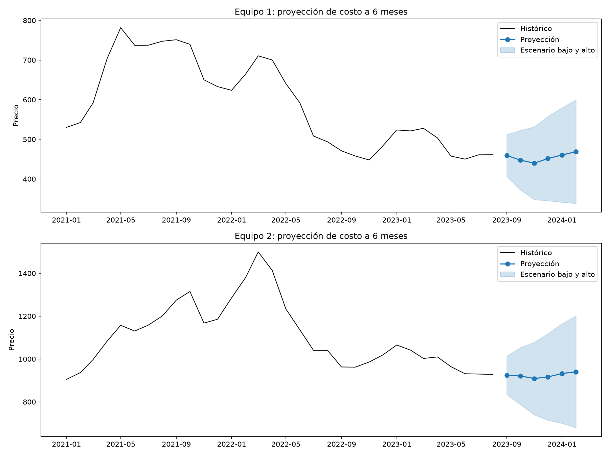
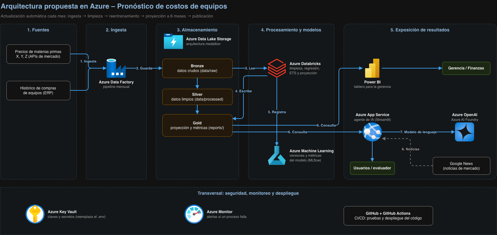

# Pronóstico de costos de equipos a partir de materias primas

Análisis y proyección del costo de dos equipos de construcción a partir del precio de sus materias primas (X, Y y Z), con un agente de IA que responde preguntas combinando la proyección con noticias actuales del mercado, y una propuesta de arquitectura en Azure.

## Descripción del caso

Una empresa de construcción que está planificando un proyecto necesita estimar el costo de dos equipos (Equipo 1 y Equipo 2), cuyos precios han sido muy volátiles. El proyecto responde:

1. ¿Qué materias primas explican el precio de cada equipo y cuáles son ruido?
2. ¿Cuánto costarán los equipos en los próximos meses, con qué rango y hasta qué horizonte es confiable proyectar?

El análisis completo está en el **[informe](reports/informe.md)**.

## Resultados principales

| Pregunta | Resultado |
|---|---|
| ¿Qué explica el Equipo 1? | X e Y, con receta ≈ 0,2·X + 0,8·Y. Por sus precios, **Y aporta cerca del 97% del precio**. **Z es ruido** (p-valor 0,999) |
| ¿Qué explica el Equipo 2? | X, Y y Z, con receta ≈ promedio simple de las tres. Por sus precios, **Z aporta cerca del 76%**, Y el 21% y X el 3%. Ninguna es ruido |
| Precisión del modelo de relación | Error promedio (MAPE) de 1,5% en datos de 2022-2023 que el modelo no vio |
| Horizonte de proyección | 6 meses, con actualización mensual: hasta el mes 6 el error se mantiene controlado (máximo 15,7%) y desde el mes 7 se dispara (hasta 48% en X) |
| Validación con datos reales | La proyección de X tuvo 6,83% de error frente a los precios reales, siempre dentro del intervalo de predicción |

**Proyección del costo (septiembre 2023 a febrero 2024)**, con un escenario esperado y un rango conservador (escenarios bajo y alto):

| Mes | Equipo 1 esperado | Equipo 1 bajo a alto | Equipo 2 esperado | Equipo 2 bajo a alto |
|---|---|---|---|---|
| Sep 2023 | 459 | 406 a 512 | 923 | 834 a 1.013 |
| Oct 2023 | 448 | 373 a 522 | 921 | 788 a 1.053 |
| Nov 2023 | 440 | 348 a 532 | 909 | 740 a 1.078 |
| Dic 2023 | 451 | 345 a 558 | 916 | 714 a 1.118 |
| Ene 2024 | 460 | 341 a 579 | 932 | 700 a 1.165 |
| Feb 2024 | 469 | 338 a 599 | 940 | 680 a 1.201 |



## Estructura del proyecto

```
pronostico-costos-equipos/
├── data/
│   ├── raw/                  # Datos originales, sin modificar
│   └── processed/            # Datos limpios generados por el código (no se suben a GitHub)
├── notebooks/
│   ├── 01_exploracion_datos.ipynb     # Carga, calidad y limpieza de los datos
│   ├── 02_analisis_exploratorio.ipynb # Series, correlación, variabilidad y estacionalidad
│   ├── 03_modelo_relacion.ipynb       # Regresión: qué materias primas explican cada equipo
│   ├── 04_proyeccion.ipynb            # Selección del método, horizonte y proyección
│   └── 05_agente_ia.ipynb             # Pruebas del agente de IA
├── src/
│   ├── herramientas.py       # Herramientas del agente (proyección, modelo y noticias)
│   └── agente.py             # Agente de IA con Gemini
├── reports/
│   ├── figures/              # Gráficas generadas
│   ├── informe.md            # Informe de la prueba
│   ├── proyeccion_costos_equipos.csv
│   └── resultados_modelo.json
├── docs/                     # Diagrama de arquitectura en Azure
├── app.py                    # Interfaz de chat del agente (Streamlit)
├── requirements.txt          # Librerías del proyecto, con versiones fijas
└── README.md
```

## Cómo ejecutar

### 1. Requisitos

- Python 3.13
- Una API key de Gemini (gratuita) para el agente de IA: [Google AI Studio](https://aistudio.google.com/apikey)

### 2. Instalación

```bash
git clone https://github.com/secasospina/pronostico-costos-equipos.git
cd pronostico-costos-equipos

python3.13 -m venv .venv
source .venv/bin/activate        # En Windows: .venv\Scripts\activate
pip install -r requirements.txt
```

### 3. Configurar la API key

Copia el archivo de ejemplo y escribe tu clave:

```bash
cp .env.example .env
```

```
GEMINI_API_KEY=tu_clave_aqui
```

El archivo `.env` está en el `.gitignore`, así que la clave nunca se sube al repositorio.

### 4. Ejecutar los notebooks

Ejecutar en orden, de `01` a `04`. Cada uno genera los archivos que usa el siguiente:

1. `01_exploracion_datos.ipynb` genera los datos limpios en `data/processed/`.
2. `02_analisis_exploratorio.ipynb` genera las gráficas del análisis.
3. `03_modelo_relacion.ipynb` genera `reports/resultados_modelo.json`.
4. `04_proyeccion.ipynb` genera `reports/proyeccion_costos_equipos.csv`.

El notebook `05_agente_ia.ipynb` contiene pruebas del agente y consume cuota de la API.

### 5. Ejecutar el agente de IA

```bash
streamlit run app.py
```

Se abre un chat en el navegador. Ejemplos de preguntas:

- ¿Cuánto costará el Equipo 2 en diciembre?
- ¿De qué depende el precio del Equipo 1?
- ¿Qué está pasando con el petróleo y cómo afecta los costos?

El agente decide qué herramienta usar (la proyección, los resultados del modelo o las noticias de Google News), recuerda la conversación y muestra las fuentes consultadas. Usa el plan gratuito de Gemini; puede pasar a un plan de pago sin cambiar el código.

## Arquitectura propuesta en Azure



Propuesta para llevar la solución a producción con actualización mensual automática: Data Factory trae los datos, Data Lake los guarda en capas Bronze, Silver y Gold (equivalentes a `data/raw`, `data/processed` y `reports/`), Databricks procesa y entrena, Azure Machine Learning registra cada versión del modelo, y los resultados se exponen en Power BI y en el agente (App Service + Azure OpenAI). El diagrama editable está en `docs/arquitectura_azure.drawio`.

## Tecnologías

Python · pandas · statsmodels (regresión OLS y suavizado exponencial ETS) · scikit-learn · matplotlib · seaborn · Gemini API (google-genai) · Streamlit · draw.io

## Autor

**Sebastián Castaño Ospina** – [secasospina@gmail.com](mailto:secasospina@gmail.com)
