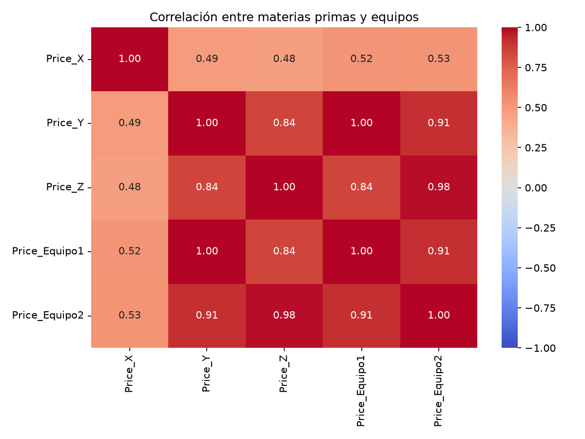
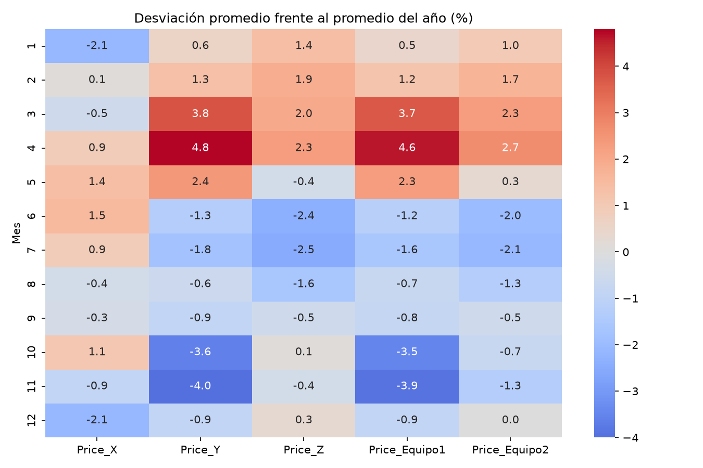
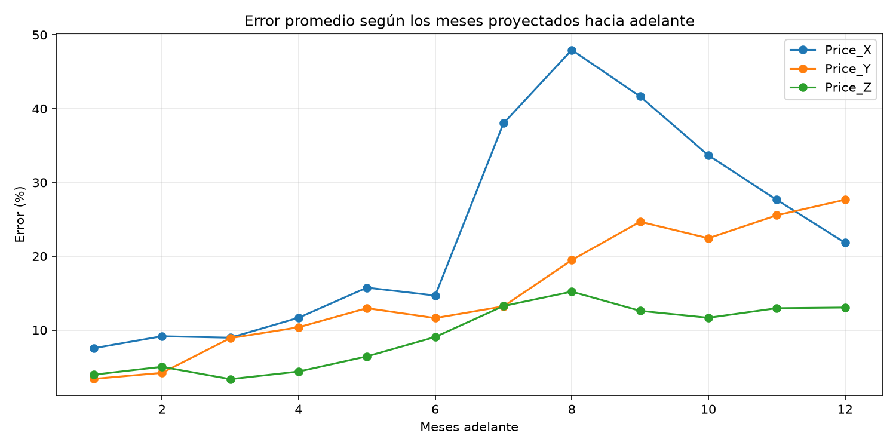

# Informe – Pronóstico de costos de equipos a partir de materias primas

**Autor:** Sebastián Castaño Ospina 
**Proceso:** Data Scientist – DataKnow 
**Fecha:** noviembre de 2026

## 1. Explicación del caso

Una empresa de construcción se encuentra en una etapa de planificación de un proyecto y necesita estimar cuánto le costarán dos equipos (Equipo 1 y Equipo 2). Hasta el momento no ha sido posible hacer esa planificación, porque durante muchos años estos equipos han tenido costos muy volátiles: unos meses más caros y otros más económicos. La empresa desconoce el motivo de esta inestabilidad, es decir, si se debe a los precios de sus materias primas X, Y y Z, o a otros factores.

Se presume que el costo de cada equipo depende de tres variables, que corresponden a las materias primas X, Y y Z. Estas materias primas son insumos relacionados con los equipos; por lo tanto, cuando suben o bajan de precio, también afectan directamente el costo del Equipo 1 y del Equipo 2 (cada uno con sus propias materias primas). Adicionalmente, se estima que alguna o algunas de estas materias primas no tengan relación con el costo de algún equipo, es decir, que sean ruido en su estimación.

La empresa no solo necesita saber cuánto costarán los equipos en los próximos meses, sino también estimar cuánto podrá costar mantener el proyecto, para planificar su presupuesto y sus compras. Como el comportamiento de los precios ha sido volátil, se requiere un rango que indique cuál puede ser el costo mínimo y máximo de cada equipo. Además, es necesario definir un horizonte de predicción, es decir, hasta cuántos meses se puede proyectar con confianza, ya que a mayor distancia en el tiempo, mayor es la incertidumbre.

Para resolver el caso se contó con cuatro archivos de precios diarios: las materias primas X, Y y Z, y el histórico de precios del Equipo 1 y el Equipo 2, entre enero de 2010 y agosto de 2023. La materia prima X tiene datos posteriores a esa fecha, que se usaron para validar la proyección con valores reales.

Como resultado se entregan: el análisis exploratorio de los datos, un modelo que identifica qué materias primas explican el precio de cada equipo, la proyección de costos a 6 meses con un escenario esperado, uno bajo y uno alto, un agente de IA que responde preguntas combinando la proyección con noticias actuales del mercado, y una propuesta de arquitectura en Azure para llevar la solución a producción.

## 2. Supuestos

Para resolver el caso partí de estos supuestos:

1. Las únicas variables que tengo para explicar el precio de los equipos son X, Y y Z. Hay otros factores que seguramente influyen (transporte, tasa de cambio, margen del proveedor, demanda), pero no vienen en los datos, así que no los incluí.
2. La relación entre las materias primas y el precio de cada equipo es lineal y se mantiene en el tiempo. Esto lo comprobé: un modelo entrenado con 2010-2021 se equivocó en promedio solo 1,5% en 2022-2023.
3. Todos los precios están en la misma moneda y unidad, y no los ajusté por inflación, porque el caso no da esa información.
4. Tomé el histórico consolidado como fuente principal, después de verificar que sus precios coinciden al 100% con los archivos de X, Y y Z en las 3.530 fechas que tienen en común.
5. Los días que no aparecen son fines de semana y festivos. El histórico solo tiene días hábiles y el salto más largo entre dos fechas es de 4 días, así que no rellené datos.
6. La empresa planifica por mes, porque los presupuestos se hacen así. Por eso proyecté con el promedio mensual de los precios.
7. En el corto plazo, los patrones del pasado (tendencia y estacionalidad) se mantienen. Eventos como la caída de 2014-2016 o la pandemia de 2020 no se pueden anticipar con datos históricos, y esa es una de las razones para no proyectar muy lejos.
8. Proyecto con la información que había en agosto de 2023. X, Y y Z se proyectan; los precios reales de X que vienen después de esa fecha los usé solo para validar, no para calcular.
9. El rango de costos es un escenario conservador: el escenario bajo y el alto suponen que X, Y y Z llegan a su extremo al mismo tiempo. Por eso es más amplio que un intervalo estadístico del 95% y no equivale a una probabilidad exacta.
10. Los intervalos de predicción de cada materia prima son del 95%.
11. El caso no dice qué son X, Y y Z. Lo que encontré sobre el petróleo Brent y el aluminio (sección 5.1) lo presento como hipótesis, no como un hecho.
12. El proyecto necesita conocer al menos los costos de los próximos 6 meses. Si se necesita más tiempo, la proyección se va renovando cada mes.

## 3. Formas para resolver el caso y la opción tomada en esta prueba

El caso en realidad tiene dos preguntas diferentes, y cada una se puede resolver de varias formas. Aquí explico cuáles consideré y por qué me quedé con la que usé.

### 3.1 ¿Qué materias primas explican el precio de cada equipo?

| Opción | Ventaja | Limitación |
|---|---|---|
| Correlación simple | Muy rápida de calcular e interpretar | Compara de a dos variables y se confunde cuando las materias primas se parecen entre sí (Y y Z tienen una correlación de 0,84) |
| **Regresión lineal múltiple (opción tomada)** | Analiza todas las materias primas al mismo tiempo, separa el efecto de cada una y entrega el peso (coeficiente) y la evidencia estadística (p-valor) de cada variable | Supone una relación lineal |
| Modelos de machine learning (por ejemplo, Random Forest) | Capturan relaciones no lineales | Son menos interpretables y no se justifican si un modelo lineal ya explica el 99% del precio |

Me quedé con la regresión lineal múltiple (OLS) porque responde justo lo que pregunta el caso. El coeficiente dice cuánto cambia el precio del equipo cuando la materia prima sube una unidad, el p-valor dice si esa materia prima de verdad influye o es ruido (si es menor a 0,05, influye), y con los dos se puede calcular cuánto aporta cada una al precio. La correlación la usé solo al principio, para explorar.

### 3.2 ¿Cómo proyectar el costo de los equipos?

Había dos caminos posibles:

- Proyectar directamente el precio de cada equipo, como una serie de tiempo.
- Proyectar en dos etapas: primero los precios de X, Y y Z, y luego calcular el precio de cada equipo con la "receta" que sale de la regresión.

Elegí las dos etapas. Así no solo sé cuánto va a costar el equipo, sino por qué: qué materia prima lo está moviendo. Además me permite armar escenarios por materia prima, comparar la proyección de X con los precios reales que ya se conocen y conectar todo con las noticias de materias primas, que es lo que usa el agente de IA.

Para proyectar las materias primas comparé estos métodos:

| Método | Cómo funciona | Ventaja | Limitación |
|---|---|---|---|
| Ingenuo | El próximo mes cuesta igual que el último mes conocido | Muy simple; sirve como línea base | No considera tendencia ni estacionalidad |
| Promedio móvil | El próximo mes es el promedio de los últimos meses | Simple y estable | No considera estacionalidad y reacciona tarde a los cambios |
| **Suavizado exponencial ETS (opción tomada)** | Promedio que da más peso a lo reciente y aprende tendencia y estacionalidad | Captura la estacionalidad, entrega intervalos de predicción y es fácil de explicar | Supone que los patrones del pasado se mantienen |
| ARIMA / SARIMA | Modela cómo se relaciona cada mes con los anteriores | Muy flexible | Más difícil de ajustar y de explicar |

Usé el suavizado exponencial (ETS) con estacionalidad de 12 meses, pero siempre comparándolo con el método ingenuo. La idea es simple: si un método más complicado no le gana a "repetir el último precio", no tiene sentido usarlo. Probé dos versiones del ETS (con tendencia amortiguada y sin tendencia) y escogí la mejor para cada materia prima, validando en varias ventanas de tiempo (sección 4.4).

También decidí trabajar con datos mensuales y no diarios: la planificación financiera es mensual, el promedio del mes quita el ruido del día a día y la estacionalidad que encontré también es mensual.

### 3.3 Agente de IA

Primero, la diferencia entre una IA convencional y un agente:

- Una IA convencional recibe datos y devuelve una respuesta, siempre de la misma forma. Un ejemplo es la regresión de este mismo proyecto: le entran los precios de X, Y y Z y sale el precio del equipo. Funciona como una calculadora.
- Un agente de IA recibe un objetivo, decide qué pasos seguir, usa herramientas y junta los resultados en una respuesta. Funciona más como un asistente.

| Característica | Qué significa | En el agente de este proyecto |
|---|---|---|
| Percepción | Recibe información de su entorno | Lee la pregunta del usuario y los titulares de noticias recientes |
| Autonomía | Decide solo qué pasos seguir | Según la pregunta, elige qué herramienta usar |
| Uso de herramientas | Ejecuta funciones externas | Consulta la proyección, el modelo y las noticias |
| Memoria | Recuerda lo que se habló | Mantiene el contexto de la conversación |
| Capacidad de acción | Hace cosas, no solo responde | Busca información actualizada y la combina con el pronóstico |

Para construirlo pensé en tres opciones:

| Opción | Limitación |
|---|---|
| Chatbot sin herramientas | Inventa cifras, porque no tiene acceso a los resultados del análisis |
| Chatbot con los resultados copiados en las instrucciones | No puede buscar información actual del mercado |
| **Agente con herramientas (function calling) (opción tomada)** | El modelo decide qué herramienta usar, consulta los datos reales y busca noticias actuales |

Las decisiones técnicas fueron estas:

| Decisión | Qué elegí | Por qué |
|---|---|---|
| Modelo de lenguaje | Gemini (gemini-3.5-flash-lite, con gemini-3.1-flash-lite de respaldo) | Plan gratuito, soporta function calling y respondió de forma rápida y estable; el modelo flash llegó a tardar hasta 59 segundos por saturación |
| Herramientas | `consultar_proyeccion`, `consultar_modelo` y `buscar_contexto_mercado` | Las dos primeras leen los resultados guardados en `reports/`; la tercera busca noticias recientes en Google News |
| Noticias | Feed RSS de Google News (titulares, medio y fecha) | La búsqueda integrada de Gemini no está disponible en el plan gratuito; el agente trabaja con los titulares, no con el texto completo de los artículos |
| Interfaz | Chat en Streamlit (`app.py`) | Permite probar el agente desde el navegador, con las fuentes consultadas y sus enlaces |
| Robustez | Reintentos ante errores temporales (429, 500, 503) y modelo de respaldo | El agente sigue respondiendo aunque el servicio se sature |
| Seguridad | API key en un archivo `.env` ignorado por git | La clave nunca se sube al repositorio |

Con el plan gratuito de Gemini alcanza para la evaluación. Si se quisiera pasar al plan de pago, se activa desde la cuenta de Google y no hay que cambiar el código ([precios de Gemini](https://ai.google.dev/gemini-api/docs/pricing)).

### 3.4 Propuesta de arquitectura en la nube (Azure)

Propuse la arquitectura en Azure porque DataKnow es partner de Microsoft, y porque así la seguridad, los permisos, la facturación y el monitoreo quedan en un solo lugar. El diagrama muestra cómo funcionaría esto en producción: cada mes, sin que nadie tenga que hacerlo a mano, llegan los datos nuevos, se reentrena el modelo, se actualiza la proyección y se publica para la gerencia y en el agente.

| Etapa | Servicio | Función |
|---|---|---|
| Ingesta | Azure Data Factory | Trae cada mes los precios de las materias primas y el histórico de compras |
| Almacenamiento | Azure Data Lake Storage | Guarda los datos en tres capas: Bronze (crudos, `data/raw`), Silver (limpios, `data/processed`) y Gold (resultados, `reports/`) |
| Procesamiento | Azure Databricks | Ejecuta la limpieza, la regresión, el ETS y la proyección |
| Registro del modelo | Azure Machine Learning (MLflow) | Guarda cada versión del modelo con sus coeficientes y su error |
| Exposición | Power BI | Tablero para la gerencia |
| Exposición | Azure App Service + Azure OpenAI | Publica el agente de IA y le da el modelo de lenguaje |
| Transversal | Azure Key Vault, Azure Monitor, GitHub Actions | Secretos, alertas si algo falla y despliegue automático del código |

Power BI y el agente leen de la misma capa Gold, así los dos muestran siempre los mismos números. En producción cambiaría Gemini por Azure OpenAI, para que los datos de la empresa no salgan de su nube. Ese cambio es pequeño, porque el agente está separado en `src/agente.py`.

## 4. Resultados del análisis de los datos y los modelos

### 4.1 Calidad de los datos

Los cuatro archivos venían en formatos diferentes. Todo lo corregí con código, sin tocar los archivos originales, para que cualquiera pueda repetir el proceso y llegar al mismo resultado.

| Hallazgo | Archivo | Solución |
|---|---|---|
| Separador punto y coma y decimales con coma | Y | `read_csv` con `sep=";"` y `decimal=","` |
| Fechas en formato día/mes/año (las demás en año-mes-día) | Y | `pd.to_datetime` con formato explícito |
| Carácter invisible (BOM) al inicio del archivo | Y | `encoding="utf-8-sig"` |
| Columnas en orden distinto | Z | Trabajar siempre con nombres de columna |
| Series ordenadas de la más reciente a la más antigua | X, Y | Ordenar por fecha con código |

| Serie | Desde | Hasta |
|---|---|---|
| X | 1988-06-27 | 2024-04-04 |
| Y | 2006-07-11 | 2023-09-12 |
| Z | 2010-01-01 | 2023-08-31 |
| Histórico de equipos | 2010-01-04 | 2023-08-31 |

Ninguna serie tiene fechas repetidas, y los precios del histórico coinciden exactamente con los archivos originales en las 3.530 fechas comunes. El histórico solo tiene días hábiles: hay saltos de 1 día (2.808), de 3 días por fin de semana (687) y de 2 o 4 días por festivos (34), así que no había huecos que rellenar. Algo que me llamó la atención es que X tiene unos 7 meses de datos reales después de agosto de 2023, y esos meses me sirvieron para validar la proyección.

### 4.2 Análisis exploratorio

En promedio, el Equipo 1 cuesta cerca de 460 y el Equipo 2 cerca de 890.

Para comparar qué tanto varía cada serie usé el coeficiente de variación y no la desviación estándar, porque esta última hace ver más variables a las series más caras. X es la materia prima que más varía (32,3%) y Z la más estable (18,3%). El Equipo 1 varía casi igual que Y (24,7% frente a 24,9%) y el Equipo 2 casi igual que Z (19,1% frente a 18,3%).

La correlación ya daba pistas: el Equipo 1 se mueve casi igual que Y (0,997) y el Equipo 2 casi igual que Z (0,98). El problema es que Y y Z también se parecen mucho entre sí (0,84), y por eso necesitaba un modelo que separara el efecto de cada una.

Para la estacionalidad comparé cada día con el promedio de su propio año. Y y el Equipo 1 suben cerca de 4,7% en abril y bajan cerca de 4% en octubre y noviembre; Z y el Equipo 2 se mueven alrededor de ±2,5%; y X no muestra un patrón por mes.

También se ve claramente el evento de 2014-2016, cuando todas las series bajaron. X cayó cerca de 76% desde su punto más alto (junio de 2014) hasta el más bajo (enero de 2016); en promedio anual, la caída fue de cerca de 55%.

### 4.3 Modelo de relación: qué materias primas explican cada equipo

**Equipo 1** (R² = 0,995)

| Materia prima | Coeficiente | p-valor | Conclusión |
|---|---|---|---|
| X | 0,20 | 0,000 | Influye |
| Y | 0,80 | 0,000 | Influye (la que más pesa) |
| Z | ≈ 0 | 0,999 | **Ruido** |

**Equipo 2** (R² = 0,992)

| Materia prima | Coeficiente | p-valor | Conclusión |
|---|---|---|---|
| X | 0,333 | 0,000 | Influye |
| Y | 0,336 | 0,000 | Influye |
| Z | 0,332 | 0,000 | Influye |

Hay algo importante al leer estas tablas: el coeficiente no es el porcentaje del precio. Dice cuánto sube el equipo por cada unidad que sube la materia prima. Como las materias primas tienen precios muy distintos (Z cuesta cerca de 2.000, Y cerca de 550 y X cerca de 80), para saber cuánto aporta cada una al precio hay que multiplicar el coeficiente por el precio promedio de la materia prima y dividir entre el precio promedio del equipo:

| Materia prima | Aporte al precio del Equipo 1 | Aporte al precio del Equipo 2 |
|---|---|---|
| X | 3,4% | 2,9% |
| Y | 96,6% | 21,0% |
| Z | 0% (ruido) | 75,9% |

Con esto puedo responder la primera pregunta del caso:

- El precio del Equipo 1 depende de X e Y, con una receta aproximada de 0,2·X + 0,8·Y. Como Y es mucho más cara, termina aportando cerca del 97% del precio y X apenas el 3%. Z es ruido: parecía relacionada con el Equipo 1, pero solo porque se parece a Y (tienen una correlación de 0,84). Cuando el modelo ya tiene en cuenta a Y, Z no aporta nada.
- El precio del Equipo 2 depende de las tres materias primas y ninguna es ruido. La receta es casi un promedio simple de X, Y y Z (coeficiente cercano a 0,33 cada una). En las gráficas parecía que dependía solo de Z, y tiene sentido: Z aporta cerca del 76% del precio porque es la más cara, aunque por unidad pese lo mismo que las otras dos.
- En los dos equipos los coeficientes suman más o menos 1. El Equipo 1 se comporta como un promedio ponderado de X e Y, y el Equipo 2 como un promedio simple de las tres.

Para saber si el modelo de verdad funcionaba con datos que no había visto, lo entrené con 2010-2021 (3.100 días) y lo probé con 2022-2023 (430 días). Separé por fechas y no al azar, porque así es como se va a usar: aprender del pasado para predecir lo que viene.

| Equipo | MAE | MAPE |
|---|---|---|
| Equipo 1 | 8,04 | 1,51% |
| Equipo 2 | 16,34 | 1,50% |

En los dos equipos el error promedio fue de 1,5%. El MAE del Equipo 2 es el doble solo porque su precio también es el doble.

También revisé que la regresión no tuviera problemas que la hicieran engañosa. El estadístico de Durbin-Watson es de 1,96 en el Equipo 1 y 2,04 en el Equipo 2 (cercano a 2, sin autocorrelación fuerte en los residuos), y el factor de inflación de la varianza (VIF) de X, Y y Z es de 1,34, 3,61 y 3,54, muy por debajo del umbral habitual de 10, así que la correlación entre Y y Z no impide separar sus efectos. La advertencia de número de condición que muestra statsmodels se debe a la diferencia de escala entre las variables. Ya validado, volví a entrenar los modelos con todo el histórico para hacer la proyección.

### 4.4 Selección del método de pronóstico

La primera prueba me sorprendió. Proyectando los últimos 12 meses de Y, el método ingenuo le ganó al ETS con tendencia (6,67% contra 12,45% de error), y el ETS sin tendencia sacó 6,03%. El ETS con tendencia aprendió justo después de la gran subida de 2021-2022 y siguió proyectando hacia arriba, pero en 2023 el mercado bajó. Esto es bastante normal en precios de mercado, que se comportan casi como una caminata aleatoria.

Como una sola prueba puede engañar, repetí la validación en cuatro ventanas (entrenando hasta agosto de 2019, 2020, 2021 y 2022, y evaluando los 12 meses siguientes en cada caso). En total fueron 36 pruebas.

| Materia prima | ETS con tendencia | ETS sin tendencia | Ingenuo | Método elegido |
|---|---|---|---|---|
| X | 23,21% | 26,64% | 25,29% | ETS con tendencia |
| Y | 16,93% | 15,37% | 15,30% | ETS sin tendencia |
| Z | 9,24% | 10,84% | 10,60% | ETS con tendencia |

*(MAPE promedio de las 4 ventanas, a 12 meses.)*

Ningún método gana siempre, así que escogí uno para cada materia prima. En X y Z ganó el ETS con tendencia. En Y fue prácticamente un empate: el ingenuo salió apenas 0,07 puntos mejor que el ETS sin tendencia, y preferí el ETS porque recoge la estacionalidad de Y, que sirve para planear mes a mes.

### 4.5 Pruebas del agente de IA

| Pregunta | Resultado |
|---|---|
| "¿Cuánto costará el Equipo 2 en diciembre de 2023?" | 916,21 (escenario bajo 714,30 y alto 1.118,11), igual al archivo de proyección. Aclaró que la incertidumbre crece con los meses |
| "¿Y el otro equipo?" | Entendió que se refería al Equipo 1 en diciembre: 451,42 (escenario bajo 345,15 y alto 557,69), y explicó que el rango es conservador. La memoria funciona |
| "¿Qué está pasando con el precio del petróleo y cómo podría afectar estos costos?" | Buscó noticias del día y citó los medios. Relacionó X con el Brent como hipótesis, dijo que X aporta cerca del 3% del precio en ambos equipos (impacto acotado) y aclaró que las noticias son actuales mientras la proyección es de septiembre de 2023 a febrero de 2024 |

Cuando usa herramientas, el agente tardó como máximo 3,8 segundos en responder. En el camino tuve que corregir varias cosas: respuestas con datos imprecisos (reforcé las instrucciones), errores de certificados al consultar las noticias (cambié a `httpx`) y enlaces que el modelo alteraba (ahora los enlaces se muestran directamente desde la herramienta, en "Fuentes consultadas").

## 5. Proyección de costos y horizonte de predicción

### 5.1 Horizonte de predicción: 6 meses

No quise escoger el horizonte a ojo, así que medí el error del método elegido para cada mes hacia adelante, promediando las 4 ventanas de validación.

| Meses adelante | X | Y | Z |
|---|---|---|---|
| 1 | 7,5% | 3,4% | 4,0% |
| 2 | 9,2% | 4,2% | 5,0% |
| 3 | 9,0% | 8,9% | 3,4% |
| 4 | 11,7% | 10,4% | 4,4% |
| 5 | 15,7% | 13,0% | 6,4% |
| 6 | 14,7% | 11,6% | 9,1% |
| 7 | 38,0% | 13,2% | 13,3% |
| 8 | 48,0% | 19,5% | 15,2% |
| 9 | 41,7% | 24,7% | 12,6% |
| 10 | 33,7% | 22,4% | 11,7% |
| 11 | 27,7% | 25,5% | 13,0% |
| 12 | 21,8% | 27,7% | 13,1% |

Hasta el mes 6 el error crece, pero de forma controlada (el máximo es 15,7%, en X en el mes 5). Desde el mes 7 aumenta de forma marcada, sobre todo en X, que salta de 14,7% a 38%, en buena parte por el evento de 2020. Buscando qué pasó en esas fechas, encontré que los errores más grandes coinciden con dos eventos del mercado:

| Evento | Qué pasó | Cómo se ve en los datos |
|---|---|---|
| Caída del petróleo 2014-2016 | El petróleo cayó cerca de 70% entre mediados de 2014 y comienzos de 2016, por exceso de oferta y luego menor demanda ([Banco Mundial](https://blogs.worldbank.org/en/developmenttalk/what-triggered-oil-price-plunge-2014-2016-and-why-it-failed-deliver-economic-impetus-eight-charts)) | Todas las series bajaron; X cayó cerca de 76% de su punto más alto al más bajo |
| COVID-19 en 2020 | El colapso de la demanda llevó al petróleo WTI a precios negativos el 20 de abril de 2020 ([EIA](https://www.eia.gov/todayinEnergy/detail.php?id=46336)) | En la ventana entrenada hasta agosto de 2019, los meses 7 y 8 (marzo y abril de 2020) tienen el mayor error de X: 38% y 48% |

Ningún modelo con datos históricos puede anticipar algo así. Por eso definí un horizonte de 6 meses y propongo actualizar la proyección cada mes, a medida que llegan datos nuevos.

**¿Qué podrían ser X y Z?** El caso no lo dice, pero revisando los datos encontré pistas bastante fuertes:

- X se comporta como el petróleo Brent. Su máximo histórico (146,08 el 3 de julio de 2008) coincide con el récord del Brent de ese día ([Dawn](https://www.dawn.com/news/310130)). Desde 2010, su máximo (127,98 el 8 de marzo de 2022) coincide con el pico del Brent al inicio de la guerra en Ucrania ([BusinessLive](https://www.businesslive.co.za/bd/markets/2022-03-08-brent-passes-127bbl-as-supply-concerns-take-hold/)), y su mínimo (19,33 el 21 de abril de 2020) con la caída del Brent a mínimos de casi dos décadas ([Hart Energy](https://hartenergy.com/news/brent-oil-futures-drops-25-near-two-decade-lows-187168)). Además, X nunca fue negativa (el 20 de abril de 2020 valía 25,57), lo que apunta a que es Brent y no WTI.
- Z se comporta como el aluminio. Su máximo (3.984 el 7 de marzo de 2022) coincide con el récord del aluminio en la Bolsa de Metales de Londres ([AlCircle](https://www.alcircle.com/news/lme-aluminium-opens-the-week-with-a-growth-of-us133-5-t-to-us3-984-50-t-shfe-price-declines-by-us180-t-76786)).
- Y tiene su pico en mayo de 2021, pero no logré identificarla con certeza.

Lo dejo como hipótesis, porque el caso no lo confirma. Si la empresa lo confirma, se podrían usar fuentes y noticias específicas de estos mercados para mejorar la proyección.

### 5.2 Proyección de las materias primas y validación con datos reales

Proyecté cada materia prima 6 meses (de septiembre de 2023 a febrero de 2024) con el método que le correspondía, reentrenado con todo el histórico mensual y con intervalos de predicción del 95%. Los intervalos se van abriendo mes a mes: entre más lejos, más incertidumbre.

Como el archivo de X llega hasta abril de 2024, pude comparar su proyección con lo que realmente pasó. El error fue de 6,83%, incluso por debajo de lo esperado: según la tabla de error por horizonte, el error promedio de X en los primeros 6 meses es de 11,3%. Además, el precio real quedó dentro del intervalo de predicción en los 6 meses. Es una buena señal de que los intervalos son razonables, aunque seis meses de una sola ventana no alcanzan para confirmarlo del todo.

Esta comparación es solo una validación. Para la proyección oficial de los equipos usé X proyectada, porque en agosto de 2023 esos precios todavía no se conocían; usar los reales sería hacer trampa con información del futuro.

### 5.3 Proyección del costo de los equipos

Para cada mes calculé tres escenarios con la receta de cada equipo: el esperado (X, Y y Z en su valor esperado), el bajo (las tres en el límite inferior de su intervalo de predicción) y el alto (las tres en el límite superior).

| Mes | Equipo 1 esperado | Equipo 1 bajo a alto | Equipo 2 esperado | Equipo 2 bajo a alto |
|---|---|---|---|---|
| Sep 2023 | 459 | 406 a 512 | 923 | 834 a 1.013 |
| Oct 2023 | 448 | 373 a 522 | 921 | 788 a 1.053 |
| Nov 2023 | 440 | 348 a 532 | 909 | 740 a 1.078 |
| Dic 2023 | 451 | 345 a 558 | 916 | 714 a 1.118 |
| Ene 2024 | 460 | 341 a 579 | 932 | 700 a 1.165 |
| Feb 2024 | 469 | 338 a 599 | 940 | 680 a 1.201 |

Algunas cosas que se ven en la proyección:

- El costo esperado del Equipo 1 baja un poco en octubre y noviembre por la estacionalidad de Y. La diferencia es pequeña comparada con el rango, así que lo veo como una oportunidad para estar pendientes, no como algo seguro.
- El Equipo 2 se mantiene más estable, porque combina las tres materias primas y Z, que es la que más pesa, es también la más estable.
- El rango es conservador, porque supone que X, Y y Z llegan a su extremo al mismo tiempo. Es más amplio que un intervalo estadístico, pero es más seguro para presupuestar.
- El rango solo tiene en cuenta la incertidumbre de las materias primas, no el error propio de la receta. Lo medí y es muy pequeño: la desviación de los residuos mensuales es de 1,8 en el Equipo 1 y 2,7 en el Equipo 2, frente a rangos de más de 100.

Mi recomendación para la empresa es planear con el valor esperado, usar el escenario alto como tope del presupuesto (o guardar la diferencia como contingencia) y actualizar la proyección cada mes. Por ejemplo: *"Para febrero de 2024, el Equipo 1 costará alrededor de 469; el presupuesto no debería superar 599."*

El detalle completo está en `reports/proyeccion_costos_equipos.csv`.

### 5.4 Uso para evaluar y comparar proveedores

El caso menciona que uno de los beneficios esperados es poder evaluar y comparar proveedores. La receta de cada equipo sirve para eso: con el precio de las materias primas de cualquier mes, se puede calcular un "precio de referencia" del equipo. Comparando lo que cobra cada proveedor con ese precio, la empresa puede:

- ver si un proveedor cobra siempre por encima de la receta, es decir, si le está metiendo más margen que el mercado;
- negociar con argumentos: si las materias primas bajaron y el precio del equipo no, hay espacio para pedir un ajuste;
- comparar proveedores en igualdad de condiciones, quitando el efecto de las materias primas.

## 6. Futuros ajustes o mejoras

Hay varias cosas que me gustaría mejorar con más tiempo.

En el modelo y la proyección:

- Calcular el rango con simulación de Monte Carlo (miles de escenarios posibles de X, Y y Z) en vez de combinar los extremos, para tener un intervalo más ajustado.
- Si la empresa confirma qué son X, Y y Z, agregar variables externas (precio del petróleo, tasa de cambio, inflación) para predecir mejor las materias primas.
- Probar otros métodos (SARIMA, Prophet) y combinaciones de modelos, que suelen ser más estables que un solo método.
- Vigilar la receta de cada equipo: si los pesos de las materias primas cambian con el tiempo, el modelo tiene que reentrenarse o avisar.
- Hacer más sólida la validación: usar muchas más ventanas (una por mes en lugar de una por año), escoger el método con el error de los primeros 6 meses, que es el horizonte final, y medir el error de punta a punta del costo de los equipos, comparando las dos etapas contra proyectar el equipo directamente.
- Agregar diagnósticos a la regresión: pruebas sobre los residuos (estacionariedad y normalidad) y una versión del modelo en la que los coeficientes sumen 1.

En ingeniería y producción:

- Montar la arquitectura en Azure para que la ingesta, el reentrenamiento y la proyección se actualicen solos cada mes.
- Pasar la lógica de los notebooks a scripts y un pipeline, con pruebas automáticas (pytest) y CI/CD con GitHub Actions.
- Dejar en `requirements.txt` solo las dependencias directas del proyecto.

En el agente de IA:

- Publicarlo (en Streamlit Community Cloud o Azure App Service) para que se pueda usar desde un enlace.
- Cambiar a Azure OpenAI en producción.
- Agregarle una herramienta para simular escenarios, que responda preguntas como *"¿qué pasa con el Equipo 1 si Y sube 10%?"*, y otra que compare el precio de un proveedor con el precio de referencia.
- Evaluar sus respuestas con un conjunto de preguntas de prueba, para medir qué tan preciso es.

## 7. Apreciaciones y comentarios del caso

Lo que más me dejó este caso es que entender bien los datos pesa tanto como el modelo. Al principio la correlación hacía pensar que Z influía en el Equipo 1 y que el Equipo 2 dependía solo de Z. La regresión mostró otra cosa: Z es ruido en el Equipo 1, y en el Equipo 2 las tres materias primas pesan lo mismo por unidad. También aprendí a no confundir el coeficiente con lo que de verdad aporta cada materia prima al precio.

Otra lección fue comparar siempre contra algo simple. El método ingenuo fue muy difícil de superar, y eso me confirmó que en precios de mercado un modelo más complejo no siempre es mejor. Validar en varias ventanas fue lo que me permitió escoger con criterio y no por intuición.

Por último, una proyección solo sirve si se mantiene al día. Por eso mi propuesta no termina en un número, sino en un proceso: un horizonte de 6 meses que se renueva cada mes, un agente que junta la proyección con lo que está pasando en el mercado y una arquitectura que lo hace automático.

Agradezco a DataKnow la oportunidad de participar en este proceso.
