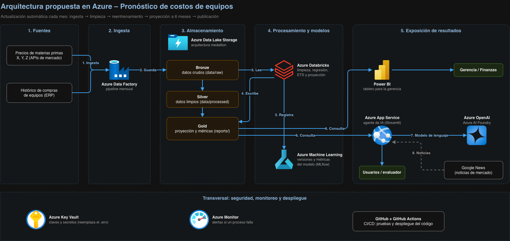
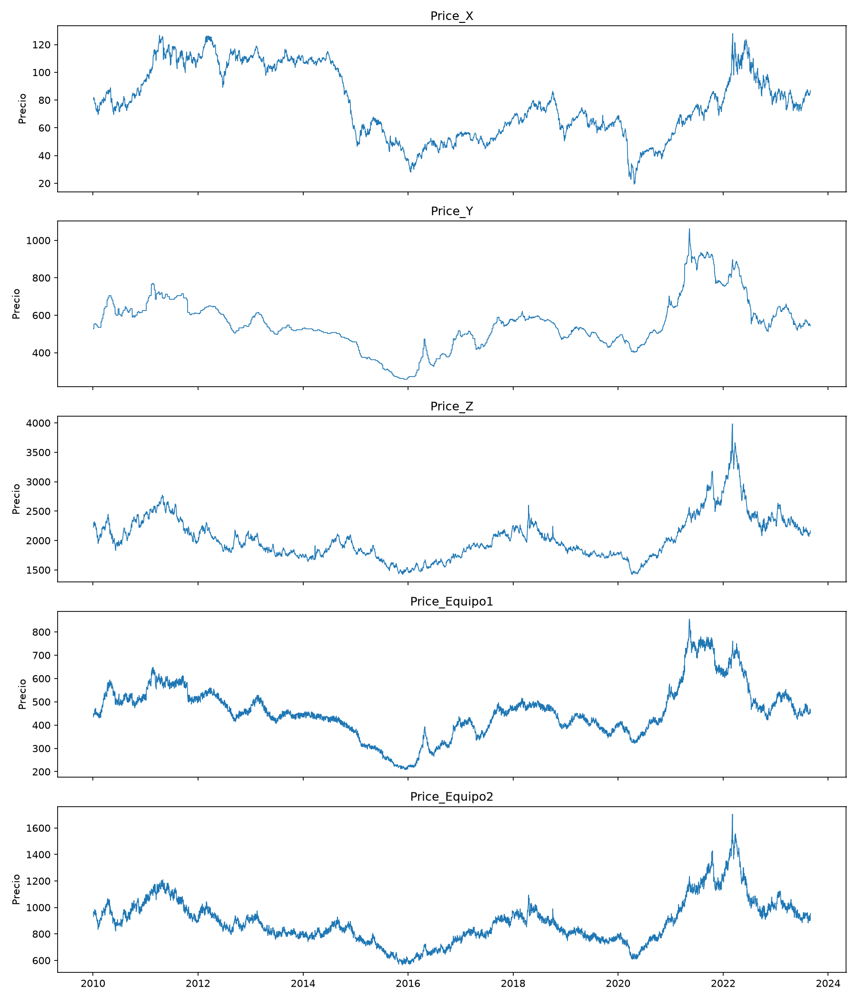
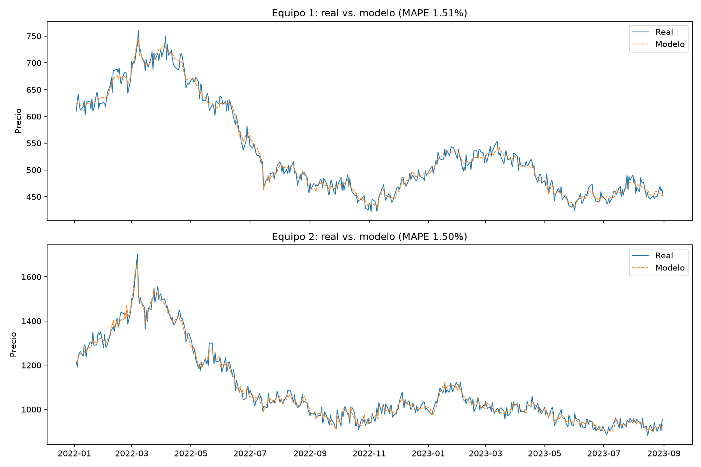
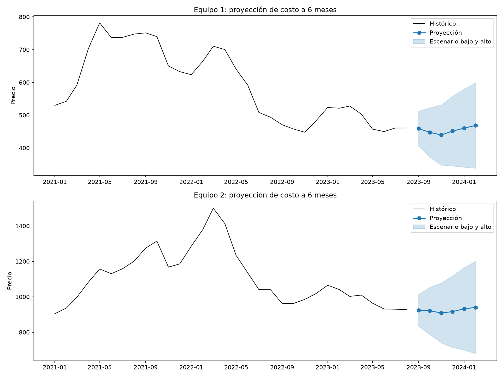

# Informe – Pronóstico de costos de equipos a partir de materias primas

**Autor:** Sebastián Castaño Ospina
**Proceso:** Data Scientist – DataKnow
**Fecha:** noviembre de 2026

## 1. Explicación del caso

Una empresa de construcción se encuentra en una etapa de planificación de un proyecto y necesita estimar cuánto le costarán dos equipos (Equipo 1 y Equipo 2). Hasta el momento no ha sido posible hacer esa planificación, porque durante muchos años estos equipos han tenido costos muy volátiles: unos meses más caros y otros más económicos. La empresa desconoce el motivo de esta inestabilidad, es decir, si se debe a los precios de sus materias primas X, Y y Z, o a otros factores.

Se presume que el costo de cada equipo depende de tres variables, que corresponden a las materias primas X, Y y Z. Estas materias primas son insumos relacionados con los equipos; por lo tanto, cuando suben o bajan de precio, también afectan directamente el costo del Equipo 1 y del Equipo 2 (cada uno con sus propias materias primas). Adicionalmente, se estima que alguna o algunas de estas materias primas no tengan relación con el costo de algún equipo, es decir, que sean ruido en su estimación.

La empresa no solo necesita saber cuánto costarán los equipos en los próximos meses, sino también estimar cuánto podrá costar mantener el proyecto, para planificar su presupuesto y sus compras. Como el comportamiento de los precios ha sido volátil, se requiere un rango que indique cuál puede ser el costo mínimo y máximo de cada equipo. Además, es necesario definir un horizonte de predicción, es decir, hasta cuántos meses se puede proyectar con confianza, ya que a mayor distancia en el tiempo, mayor es la incertidumbre.

Para resolver el caso se contó con cuatro archivos de precios diarios: las materias primas X, Y y Z, y el histórico de precios del Equipo 1 y el Equipo 2, entre enero de 2010 y agosto de 2023. La materia prima X tiene datos posteriores a esa fecha, que se usaron para validar la proyección con valores reales.

Como resultado se entregan: el análisis exploratorio de los datos, un modelo que identifica qué materias primas explican el precio de cada equipo, la proyección de costos a 6 meses con un escenario esperado, uno bajo y uno alto, un agente de IA que responde preguntas combinando la proyección con noticias actuales del mercado, y una propuesta de arquitectura en Azure para llevar la solución a producción.

## 2. Supuestos

Para resolver el caso se tomaron los siguientes supuestos:

1. **Las materias primas X, Y y Z son las únicas variables explicativas disponibles.** Otros factores que podrían influir en el precio de los equipos (transporte, tasa de cambio, margen del proveedor, demanda) no están en los datos y no se incluyen.
2. **La relación entre las materias primas y el precio de cada equipo es lineal y estable en el tiempo.** Este supuesto se validó: un modelo entrenado con 2010-2021 se equivocó en promedio solo un 1,5% en 2022-2023.
3. **Todos los precios están en la misma moneda y unidad, y no se ajustan por inflación**, porque el caso no entrega esa información.
4. **El histórico consolidado es la fuente principal.** Se verificó que sus precios coinciden al 100% con los archivos originales de X, Y y Z en las 3.530 fechas comunes.
5. **Los días sin registro corresponden a fines de semana y festivos.** El histórico solo tiene días hábiles y el salto máximo entre fechas es de 4 días, por lo que no se imputan datos.
6. **La planificación de la empresa es mensual.** Los presupuestos se hacen por mes, así que la proyección se construye con el promedio mensual de los precios.
7. **Los patrones del pasado (tendencia y estacionalidad) se mantienen en el corto plazo.** Eventos extremos como la caída de las materias primas de 2014-2016 o la pandemia de 2020 no se pueden anticipar con datos históricos; por eso el horizonte de proyección es corto.
8. **La proyección se hace con la información disponible en agosto de 2023.** X, Y y Z se proyectan; los precios reales de X posteriores a esa fecha se usan solo para validar la proyección, no para calcularla.
9. **El rango de costos es un escenario conservador:** el escenario bajo y el alto suponen que X, Y y Z llegan a su extremo al mismo tiempo. Por eso es más amplio que un intervalo estadístico del 95% y no equivale a una probabilidad exacta.
10. **Los intervalos de predicción de cada materia prima son del 95%.**
11. **El caso no indica qué son X, Y y Z.** Las coincidencias encontradas con el petróleo Brent y el aluminio (sección 5.1) se presentan como hipótesis, no como hechos.
12. **El proyecto de la empresa requiere al menos los próximos 6 meses de costos.** Para periodos más largos, la proyección se renueva cada mes.

## 3. Formas para resolver el caso y la opción tomada en esta prueba

El caso tiene dos preguntas distintas, y cada una admite varias formas de resolverse.

### 3.1 ¿Qué materias primas explican el precio de cada equipo?

| Opción | Ventaja | Limitación |
|---|---|---|
| Correlación simple | Muy rápida de calcular e interpretar | Compara de a dos variables y se confunde cuando las materias primas se parecen entre sí (Y y Z tienen una correlación de 0,84) |
| **Regresión lineal múltiple (opción tomada)** | Analiza todas las materias primas al mismo tiempo, separa el efecto de cada una y entrega el peso (coeficiente) y la evidencia estadística (p-valor) de cada variable | Supone una relación lineal |
| Modelos de machine learning (por ejemplo, Random Forest) | Capturan relaciones no lineales | Son menos interpretables y no se justifican si un modelo lineal ya explica el 99% del precio |

Se eligió la **regresión lineal múltiple (OLS)** porque responde directamente la pregunta del caso: el coeficiente indica cuánto cambia el precio del equipo por cada unidad que sube la materia prima, el p-valor indica si es significativa o ruido (p-valor menor a 0,05 = influye), y con ambos se calcula el aporte de cada materia prima al precio. La correlación se usó solo como exploración inicial.

### 3.2 ¿Cómo proyectar el costo de los equipos?

Se consideraron dos enfoques:

- **Proyectar directamente el precio de cada equipo** como una serie de tiempo.
- **Proyectar en dos etapas (opción tomada):** primero se proyectan los precios de X, Y y Z, y luego se calcula el precio de cada equipo aplicando la "receta" obtenida con la regresión.

Se eligió el enfoque en dos etapas porque explica el porqué del costo (qué materia prima lo mueve), permite construir escenarios por materia prima, permite validar la proyección de X con los precios reales que ya se conocen y conecta la proyección con noticias del mercado de materias primas, que es lo que usa el agente de IA.

Para proyectar las materias primas se compararon estos métodos:

| Método | Cómo funciona | Ventaja | Limitación |
|---|---|---|---|
| Ingenuo | El próximo mes cuesta igual que el último mes conocido | Muy simple; sirve como línea base | No considera tendencia ni estacionalidad |
| Promedio móvil | El próximo mes es el promedio de los últimos meses | Simple y estable | No considera estacionalidad y reacciona tarde a los cambios |
| **Suavizado exponencial ETS (opción tomada)** | Promedio que da más peso a lo reciente y aprende tendencia y estacionalidad | Captura la estacionalidad, entrega intervalos de predicción y es fácil de explicar | Supone que los patrones del pasado se mantienen |
| ARIMA / SARIMA | Modela cómo se relaciona cada mes con los anteriores | Muy flexible | Más difícil de ajustar y de explicar |

Se eligió el **suavizado exponencial (ETS)** con estacionalidad de 12 meses, comparándolo siempre contra el **método ingenuo como línea base**: un método más complejo solo se justifica si supera al más simple. Se probaron dos variantes (con tendencia amortiguada y sin tendencia) y se eligió la mejor para cada materia prima mediante validación en varias ventanas de tiempo (ver sección 4.4).

Además, se trabajó con **datos mensuales en lugar de diarios**, porque la planificación financiera es mensual, el promedio mensual suaviza el ruido del día a día y la estacionalidad encontrada es mensual.

### 3.3 Agente de IA

**Diferencia entre una IA convencional y un agente de IA:**

- Una **IA convencional** recibe datos y devuelve una respuesta, siempre de la misma forma. Ejemplo: el modelo de regresión de este proyecto, al que entran precios de X, Y y Z y sale el precio del equipo. Es como una calculadora.
- Un **agente de IA** recibe un objetivo, decide qué pasos seguir, usa herramientas y combina los resultados en una respuesta. Es como un asistente.

| Característica | Qué significa | En el agente de este proyecto |
|---|---|---|
| Autonomía | Decide solo qué pasos seguir | Según la pregunta, elige qué herramienta usar |
| Uso de herramientas | Ejecuta funciones externas | Consulta la proyección, el modelo y las noticias |
| Memoria | Recuerda lo que se habló | Mantiene el contexto de la conversación |
| Capacidad de acción | Hace cosas, no solo responde | Busca información actualizada y la combina con el pronóstico |

**Opciones consideradas para construir el agente:**

| Opción | Limitación |
|---|---|
| Chatbot sin herramientas | Inventa cifras, porque no tiene acceso a los resultados del análisis |
| Chatbot con los resultados copiados en las instrucciones | No puede buscar información actual del mercado |
| **Agente con herramientas (function calling) (opción tomada)** | El modelo decide qué herramienta usar, consulta los datos reales y busca noticias actuales |

**Decisiones técnicas:**

| Decisión | Qué se eligió | Por qué |
|---|---|---|
| Modelo de lenguaje | Gemini (gemini-3.5-flash-lite, con gemini-3.1-flash-lite de respaldo) | Plan gratuito, soporta function calling y respondió de forma rápida y estable; el modelo flash llegó a tardar hasta 59 segundos por saturación |
| Herramientas | `consultar_proyeccion`, `consultar_modelo` y `buscar_contexto_mercado` | Las dos primeras leen los resultados guardados en `reports/`; la tercera busca noticias recientes en Google News |
| Noticias | Feed RSS de Google News | La búsqueda integrada de Gemini no está disponible en el plan gratuito |
| Interfaz | Chat en Streamlit (`app.py`) | Permite probar el agente desde el navegador, con las fuentes consultadas y sus enlaces |
| Robustez | Reintentos ante errores temporales (429, 500, 503) y modelo de respaldo | El agente sigue respondiendo aunque el servicio se sature |
| Seguridad | API key en un archivo `.env` ignorado por git | La clave nunca se sube al repositorio |

El plan gratuito de Gemini es suficiente para la evaluación; el plan de pago se activa desde la cuenta de Google sin cambiar el código ([precios de Gemini](https://ai.google.dev/gemini-api/docs/pricing)).

### 3.4 Propuesta de arquitectura en la nube (Azure)

Se eligió **Azure** porque DataKnow es partner de Microsoft, y porque concentra en un solo proveedor la seguridad, los permisos, la facturación y el monitoreo. La arquitectura muestra cómo funcionaría la solución en producción: cada mes, sin intervención manual, se traen datos nuevos, se reentrena el modelo, se actualiza la proyección y se publica para la gerencia y en el agente.

| Etapa | Servicio | Función |
|---|---|---|
| Ingesta | Azure Data Factory | Trae cada mes los precios de las materias primas y el histórico de compras |
| Almacenamiento | Azure Data Lake Storage | Guarda los datos en tres capas: Bronze (crudos, `data/raw`), Silver (limpios, `data/processed`) y Gold (resultados, `reports/`) |
| Procesamiento | Azure Databricks | Ejecuta la limpieza, la regresión, el ETS y la proyección |
| Registro del modelo | Azure Machine Learning (MLflow) | Guarda cada versión del modelo con sus coeficientes y su error |
| Exposición | Power BI | Tablero para la gerencia |
| Exposición | Azure App Service + Azure OpenAI | Publica el agente de IA y le da el modelo de lenguaje |
| Transversal | Azure Key Vault, Azure Monitor, GitHub Actions | Secretos, alertas si algo falla y despliegue automático del código |

Power BI y el agente leen la misma capa Gold, de modo que siempre muestran los mismos números (una única fuente de verdad). En producción se usaría Azure OpenAI en lugar de Gemini, para que los datos de la empresa no salgan de su nube; el cambio es pequeño porque el agente está separado en `src/agente.py`.

## 4. Resultados del análisis de los datos y los modelos

### 4.1 Calidad de los datos

Los cuatro archivos venían en formatos distintos, y todos los ajustes se hicieron con código, sin editar los archivos originales, para que el proceso sea reproducible.

| Hallazgo | Archivo | Solución |
|---|---|---|
| Separador punto y coma y decimales con coma | Y | `read_csv` con `sep=";"` y `decimal=","` |
| Fechas en formato día/mes/año (las demás en año-mes-día) | Y | `pd.to_datetime` con formato explícito |
| Carácter invisible (BOM) al inicio del archivo | Y | `encoding="utf-8-sig"` |
| Columnas en orden distinto | Z | Trabajar siempre con nombres de columna |
| Series ordenadas de la más reciente a la más antigua | X, Y | Ordenar por fecha con código |

| Serie | Desde | Hasta |
|---|---|---|
| X | 1988-06-27 | 2024-04-04 |
| Y | 2006-07-11 | 2023-09-12 |
| Z | 2010-01-01 | 2023-08-31 |
| Histórico de equipos | 2010-01-04 | 2023-08-31 |

- Ninguna serie tiene fechas duplicadas.
- Los precios del histórico coinciden exactamente con los archivos originales en las 3.530 fechas comunes.
- El histórico solo tiene días hábiles: saltos de 1 día (2.808), de 3 días por fin de semana (687) y de 2 o 4 días por festivos (34). No hay huecos que imputar.
- X tiene unos 7 meses de datos reales después de agosto de 2023, que se usaron para validar la proyección.

### 4.2 Análisis exploratorio

- **Promedios:** Equipo 1 ≈ 460 y Equipo 2 ≈ 890.
- **Variabilidad (coeficiente de variación):** X es la materia prima más variable (32,3%) y Z la más estable (18,3%). El Equipo 1 varía como Y (24,7% frente a 24,9%) y el Equipo 2 como Z (19,1% frente a 18,3%). Se usó el coeficiente de variación y no la desviación estándar, porque esta última hace parecer más variables a las series más caras.
- **Correlación:** el Equipo 1 se relaciona fuertemente con Y (0,997) y el Equipo 2 con Z (0,98). Y y Z también están muy relacionadas entre sí (0,84), lo que obliga a usar un modelo que separe sus efectos.

- **Estacionalidad:** comparando cada día con el promedio de su propio año, Y y el Equipo 1 suben cerca de 4,7% en abril y bajan cerca de 4% en octubre y noviembre; Z y el Equipo 2 varían ±2,5%; X no muestra un patrón mensual.

- **Evento 2014-2016:** todas las series bajaron. X cayó cerca de 76% de su punto más alto (junio de 2014) a su punto más bajo (enero de 2016); en promedio anual, la caída fue de cerca de 55%.

### 4.3 Modelo de relación: qué materias primas explican cada equipo

**Equipo 1** (R² = 0,995)

| Materia prima | Coeficiente | p-valor | Conclusión |
|---|---|---|---|
| X | 0,20 | 0,000 | Influye |
| Y | 0,80 | 0,000 | Influye (la que más pesa) |
| Z | ≈ 0 | 0,999 | **Ruido** |

**Equipo 2** (R² = 0,992)

| Materia prima | Coeficiente | p-valor | Conclusión |
|---|---|---|---|
| X | 0,333 | 0,000 | Influye |
| Y | 0,336 | 0,000 | Influye |
| Z | 0,332 | 0,000 | Influye |

**Aporte de cada materia prima al precio.** El coeficiente indica cuánto sube el precio del equipo por cada unidad que sube la materia prima, pero no es el porcentaje del precio. Como las materias primas tienen precios muy distintos (Z cuesta cerca de 2.000, Y cerca de 550 y X cerca de 80), el aporte real se calcula como coeficiente × precio promedio de la materia prima ÷ precio promedio del equipo:

| Materia prima | Aporte al precio del Equipo 1 | Aporte al precio del Equipo 2 |
|---|---|---|
| X | 3,4% | 2,9% |
| Y | 96,6% | 21,0% |
| Z | 0% (ruido) | 75,9% |

**Respuesta a la primera pregunta del caso:**

- El precio del **Equipo 1** se explica por **X e Y**, con una receta aproximada de **0,2·X + 0,8·Y**. Por sus precios, **Y aporta cerca del 97% del precio** y X cerca del 3%. **Z es ruido**: aunque está correlacionada con el Equipo 1, solo se debe a que se parece a Y (correlación de 0,84 entre Y y Z); una vez se tiene en cuenta Y, Z no aporta nada.
- El precio del **Equipo 2** se explica por **las tres materias primas**, y ninguna es ruido. Su receta es aproximadamente un **promedio simple** de X, Y y Z (coeficiente cercano a 0,33 cada una). Visualmente parecía depender solo de Z, y es porque **Z aporta cerca del 76% del precio**: es la más cara, así que domina el precio aunque su peso por unidad sea igual al de las otras.
- En ambos equipos los coeficientes suman aproximadamente 1: el Equipo 1 se comporta como un promedio ponderado de X e Y, y el Equipo 2 como un promedio simple de las tres materias primas.

**Validación con datos que el modelo no vio:** cada modelo se entrenó con 2010-2021 (3.100 días) y se evaluó con 2022-2023 (430 días). La separación es por fechas, no al azar, para simular el uso real: aprender del pasado y predecir el futuro.

| Equipo | MAE | MAPE |
|---|---|---|
| Equipo 1 | 8,04 | 1,51% |
| Equipo 2 | 16,34 | 1,50% |

El error promedio es de 1,5% en ambos equipos. El MAE del Equipo 2 es el doble solo porque su precio también es el doble. Después de validar, los modelos se reentrenaron con todo el histórico para la proyección.

### 4.4 Selección del método de pronóstico

En una primera prueba (últimos 12 meses de Y), el **método ingenuo superó al ETS con tendencia** (6,67% frente a 12,45% de error), mientras que el ETS sin tendencia obtuvo 6,03%. El ETS con tendencia aprendió justo después de la gran subida de 2021-2022 y proyectó que seguía subiendo, pero en 2023 el mercado bajó. Esto es típico de los precios de mercado, que se comportan casi como una caminata aleatoria.

Como una sola prueba puede engañar, se validó en **cuatro ventanas** (entrenando hasta agosto de 2019, 2020, 2021 y 2022 y evaluando los 12 meses siguientes): 36 pruebas en total.

| Materia prima | ETS con tendencia | ETS sin tendencia | Ingenuo | Método elegido |
|---|---|---|---|---|
| X | 23,21% | 26,64% | 25,29% | ETS con tendencia |
| Y | 16,93% | 15,37% | 15,30% | ETS sin tendencia |
| Z | 9,24% | 10,84% | 10,60% | ETS con tendencia |

*(MAPE promedio de las 4 ventanas, a 12 meses.)*

No hay un método que gane siempre, así que se eligió un método para cada materia prima. En X y Z ganó el ETS con tendencia. En Y hubo un empate técnico: el ingenuo fue apenas 0,07 puntos mejor que el ETS sin tendencia, y se prefirió el ETS porque recoge la estacionalidad de Y, útil para planear mes a mes.

### 4.5 Pruebas del agente de IA

| Pregunta | Resultado |
|---|---|
| "¿Cuánto costará el Equipo 2 en diciembre de 2023?" | Respondió con el valor esperado y el rango de diciembre, tomados del archivo de proyección: datos correctos |
| "¿Y el otro equipo?" | Entendió que se refería al Equipo 1 en diciembre y respondió con sus valores. La memoria funciona |
| "¿Qué está pasando con el petróleo y cómo afecta los costos?" | Buscó noticias del día, citó los medios, las relacionó con X como hipótesis y aclaró la diferencia entre la fecha de las noticias y la de la proyección |

Las respuestas que usan herramientas tardaron como máximo 3,8 segundos. Durante el desarrollo se corrigieron problemas como respuestas con datos imprecisos (se reforzaron las instrucciones), errores de certificados al consultar noticias (se usó `httpx`) y enlaces alterados por el modelo (los enlaces se muestran directamente desde la herramienta, en la sección "Fuentes consultadas").

## 5. Proyección de costos y horizonte de predicción

### 5.1 Horizonte de predicción: 6 meses

El horizonte no se eligió a ojo: se midió el error del método elegido para cada mes hacia adelante, promediando las 4 ventanas de validación.

| Meses adelante | X | Y | Z |
|---|---|---|---|
| 1 | 7,5% | 3,4% | 4,0% |
| 2 | 9,2% | 4,2% | 5,0% |
| 3 | 9,0% | 8,9% | 3,4% |
| 4 | 11,7% | 10,4% | 4,4% |
| 5 | 15,7% | 13,0% | 6,4% |
| 6 | 14,7% | 11,6% | 9,1% |
| 7 | 38,0% | 13,2% | 13,3% |
| 8 | 48,0% | 19,5% | 15,2% |
| 9 | 41,7% | 24,7% | 12,6% |
| 10 | 33,7% | 22,4% | 11,7% |
| 11 | 27,7% | 25,5% | 13,0% |
| 12 | 21,8% | 27,7% | 13,1% |

Hasta 6 meses el error crece de forma controlada (máximo de 15,7%, en X en el mes 5); desde el mes 7 se dispara, sobre todo en X, que pasa de 14,7% a 38%. La investigación de mercado explica los mayores errores:

| Evento | Qué pasó | Cómo se ve en los datos |
|---|---|---|
| Caída del petróleo 2014-2016 | El petróleo cayó cerca de 70% entre mediados de 2014 y comienzos de 2016, por exceso de oferta y luego menor demanda ([Banco Mundial](https://blogs.worldbank.org/en/developmenttalk/what-triggered-oil-price-plunge-2014-2016-and-why-it-failed-deliver-economic-impetus-eight-charts)) | Todas las series bajaron; X cayó cerca de 76% de su punto más alto al más bajo |
| COVID-19 en 2020 | El colapso de la demanda llevó al petróleo WTI a precios negativos el 20 de abril de 2020 ([EIA](https://www.eia.gov/todayinEnergy/detail.php?id=46336)) | En la ventana entrenada hasta agosto de 2019, los meses 7 y 8 (marzo y abril de 2020) tienen el mayor error de X: 38% y 48% |

Estos eventos no se pueden anticipar con datos históricos. Por eso se definió un **horizonte de 6 meses, con actualización mensual** de la proyección a medida que llegan datos nuevos.

**¿Qué podrían ser X y Z?** El caso no lo dice, pero los datos dan pistas fuertes:

- **X se comporta como el petróleo Brent.** Su máximo histórico (146,08 el 3 de julio de 2008) coincide con el récord del Brent de ese día ([Dawn](https://www.dawn.com/news/310130)); desde 2010, su máximo (127,98 el 8 de marzo de 2022) coincide con el pico del Brent al inicio de la guerra en Ucrania ([BusinessLive](https://www.businesslive.co.za/bd/markets/2022-03-08-brent-passes-127bbl-as-supply-concerns-take-hold/)), y su mínimo (19,33 el 21 de abril de 2020) con la caída del Brent a mínimos de casi dos décadas ([Hart Energy](https://hartenergy.com/news/brent-oil-futures-drops-25-near-two-decade-lows-187168)). X nunca fue negativa (el 20 de abril de 2020 valía 25,57), lo que indica que es Brent y no WTI.
- **Z se comporta como el aluminio.** Su máximo (3.984 el 7 de marzo de 2022) coincide con el récord del aluminio en la Bolsa de Metales de Londres ([AlCircle](https://www.alcircle.com/news/lme-aluminium-opens-the-week-with-a-growth-of-us133-5-t-to-us3-984-50-t-shfe-price-declines-by-us180-t-76786)).
- **Y** tiene su pico en mayo de 2021; no se identificó con certeza.

Se presenta como hipótesis, porque el caso no lo confirma. Si la empresa la confirma, se pueden usar fuentes de mercado y noticias específicas de estas materias primas para mejorar la proyección.

### 5.2 Proyección de las materias primas y validación con datos reales

Cada materia prima se proyectó 6 meses (septiembre de 2023 a febrero de 2024) con su método elegido, reentrenado con todo el histórico mensual, e intervalos de predicción del 95%. Los intervalos se abren mes a mes: cuanto más lejos, más incertidumbre.

**Validación con el "futuro" real:** como el archivo de X tiene datos hasta abril de 2024, se comparó su proyección con lo que realmente pasó:

- El error fue de **6,83%**, dentro de lo esperado según el error por horizonte (entre 7,5% y 15,7% en los primeros 6 meses).
- El precio real quedó **dentro del intervalo de predicción en los 6 meses**, una buena señal de que los intervalos son razonables (aunque seis meses de una sola ventana no bastan para confirmarlo).

Esta comparación es solo una validación. La proyección oficial de los equipos usa **X proyectada**, porque en agosto de 2023 esos precios todavía no se conocían; usar los precios reales sería usar información del futuro.

### 5.3 Proyección del costo de los equipos

Para cada mes se calcularon tres escenarios aplicando la receta de cada equipo: **esperado** (X, Y y Z en su valor esperado), **bajo** (X, Y y Z en el límite inferior de su intervalo de predicción) y **alto** (X, Y y Z en el límite superior).

| Mes | Equipo 1 esperado | Equipo 1 bajo a alto | Equipo 2 esperado | Equipo 2 bajo a alto |
|---|---|---|---|---|
| Sep 2023 | 459 | 406 a 512 | 923 | 834 a 1.013 |
| Oct 2023 | 448 | 373 a 522 | 921 | 788 a 1.053 |
| Nov 2023 | 440 | 348 a 532 | 909 | 740 a 1.078 |
| Dic 2023 | 451 | 345 a 558 | 916 | 714 a 1.118 |
| Ene 2024 | 460 | 341 a 579 | 932 | 700 a 1.165 |
| Feb 2024 | 469 | 338 a 599 | 940 | 680 a 1.201 |

**Interpretación:**

- El costo esperado del **Equipo 1** baja un poco en octubre y noviembre por la estacionalidad de Y. La diferencia es pequeña frente al rango, así que es una oportunidad a vigilar más que una certeza.
- El **Equipo 2** se mantiene más estable, porque combina las tres materias primas y Z es la más estable.
- El rango es **conservador**: supone que X, Y y Z llegan a su extremo al mismo tiempo. Es más amplio que un intervalo estadístico, pero seguro para presupuestar.

**Recomendación para la empresa:** planear con el valor esperado, usar el escenario alto como tope del presupuesto (o reservar una contingencia por la diferencia) y actualizar la proyección cada mes. Por ejemplo: *"Para febrero de 2024, el Equipo 1 costará alrededor de 469; el presupuesto no debería superar 599."*

El detalle completo está en `reports/proyeccion_costos_equipos.csv`.

### 5.4 Uso para evaluar y comparar proveedores

El caso menciona como beneficio esperado poder evaluar y comparar proveedores. La receta de cada equipo permite calcular un **"precio de referencia"** para cualquier mes a partir del precio de las materias primas. Al comparar lo que cobra cada proveedor con ese precio de referencia, la empresa puede:

- detectar sobrecostos: si un proveedor cobra sistemáticamente por encima de la receta, está agregando un margen mayor que el mercado;
- negociar con argumentos: si las materias primas bajaron y el precio del equipo no, hay espacio para pedir un ajuste;
- comparar proveedores en igualdad de condiciones, descontando el efecto de las materias primas.

## 6. Futuros ajustes o mejoras

**Modelo y proyección**

- Calcular el rango con **simulación de Monte Carlo** (miles de escenarios posibles de X, Y y Z) en lugar de combinar los extremos, para obtener un intervalo más ajustado.
- Si la empresa confirma qué son X, Y y Z, incluir **variables externas** (precio del petróleo, tasa de cambio, inflación) como predictores de las materias primas.
- Probar otros métodos de pronóstico (SARIMA, Prophet) y **combinaciones de modelos**, que suelen ser más estables que un solo método.
- **Monitorear la receta** de cada equipo: si los pesos de las materias primas cambian con el tiempo, el modelo debe reentrenarse o alertar.
- **Fortalecer la validación:** usar muchas más ventanas (por ejemplo, una por mes en lugar de una por año), elegir el método con el error de los primeros 6 meses (el horizonte final) y medir el error de punta a punta del costo de los equipos, comparando el enfoque en dos etapas contra proyectar el equipo directamente.
- **Diagnósticos adicionales de la regresión:** pruebas sobre los residuos (estacionariedad y normalidad) y una versión restringida del modelo en la que los coeficientes sumen 1.

**Ingeniería y producción**

- Implementar la **arquitectura en Azure** para que la ingesta, el reentrenamiento y la proyección se actualicen cada mes de forma automática.
- Pasar la lógica de los notebooks a **scripts y un pipeline**, con **pruebas automáticas** (pytest) y CI/CD con GitHub Actions.
- Reducir `requirements.txt` a las dependencias directas del proyecto.

**Agente de IA**

- **Publicar el agente** (Streamlit Community Cloud o Azure App Service) para usarlo desde un enlace.
- Migrar el modelo de lenguaje a **Azure OpenAI** en producción.
- Agregar una herramienta de **simulación de escenarios**, para responder preguntas como *"¿qué pasa con el Equipo 1 si Y sube 10%?"*, y otra que compare el precio de un proveedor con el precio de referencia.
- Evaluar las respuestas del agente con un conjunto de preguntas de prueba, para medir su precisión de forma sistemática.

## 7. Apreciaciones y comentarios del caso

Este caso mostró que entender los datos es tan importante como el modelo. La correlación sugería que Z influía en el Equipo 1 y que el Equipo 2 dependía solo de Z; la regresión múltiple mostró que Z es ruido en el Equipo 1 y que en el Equipo 2 las tres materias primas pesan lo mismo por unidad. También mostró la importancia de distinguir el coeficiente del aporte real al precio.

También fue valioso comparar siempre contra un método simple. El método ingenuo fue difícil de superar, lo que confirma que en precios de mercado un modelo más complejo no siempre es mejor, y que la validación en varias ventanas es la que permite elegir con criterio.

Finalmente, la proyección solo es útil si se mantiene actualizada. Por eso la propuesta no termina en un número, sino en un proceso: un horizonte de 6 meses que se renueva cada mes, un agente que combina la proyección con el contexto del mercado y una arquitectura que lo hace automático.

Agradezco a DataKnow la oportunidad de participar en este proceso.
